# AVASinstar

A recreation of Williams' 1983 arcade game **Sinistar**, built with .NET 10 and Avalonia UI. Fly through a
sector of drifting planetoids, shoot them to knock crystals loose, and scoop the crystals up: each one is a
Sinibomb. But the enemy's workers are gathering crystals too, and carrying them off to build the Sinistar,
a giant skull, piece by piece. When the last piece is in place it comes alive (*"Beware, I live!"*) and
hunts you down. Lasers bounce off it. Only Sinibombs can destroy it.

## Features

- **The Sinistar**: a great skull built from twenty pieces you can watch going in, with burning red eyes
  and a jaw that works when it lives. It roars, taunts you (*"I hunger!"*, *"Run, coward!"*), and eats your
  ship if it catches you.
- **Crystals and Sinibombs**: shoot planetoids to free their crystals; each crystal you collect is a
  Sinibomb (up to 20), which homes in on the Sinistar wherever it is.
- **Workers** (red) gather crystals and carry them to the building site. Shoot one carrying a crystal and
  it drops it.
- **Warriors** (blue) hunt you, and shoot planetoids to free crystals for the workers when you're not
  about.
- **Two ways to stop it**: bomb it while it's still being built, knocking pieces off, or let it come and
  fight it with thirteen Sinibombs. From the second zone on, workers patch up the damage.
- **Zones**, as on the cabinet: the first zone, then Worker, Warrior, Planetoid and Void zones in turn,
  each with a new Sinistar and a sector to match: more workers, more warriors, more rocks, or almost none.
- **A long-range scanner** showing the rocks, crystals, workers, warriors, your bombs and the Sinistar,
  which flashes red once it lives.
- **The voice**: the Sinistar's lines are spoken, pitched down and passed through an emulation of the
  cabinet's CVSD speech chip for its gritty, menacing sound, with a synthesised roar and death scream.
- **A 49-way-style stick**: fly in any direction at any speed with a gamepad stick, in eight directions from
  the keyboard, or toward the mouse pointer.
- **Synthesised sound**: shots, crystals chiming loose, bombs, explosions, the clunk of each new piece and
  the Sinistar's heartbeat once it lives.
- **Attract mode**: leave the title screen alone for 20 seconds and a computer pilot plays a silent
  demonstration.
- **Top-ten high-score table** with arcade-style initials entry.
- **Any window size**: the 4:3 screen scales to fit, letterboxed. **Ctrl+S** saves a screenshot.
- **One self-contained executable** per platform: Windows, macOS and Linux on Intel/AMD and ARM.

## Screenshots

| Title screen | Mining for crystals | The Sinistar takes shape |
|:------------:|:-------------------:|:------------------------:|
| 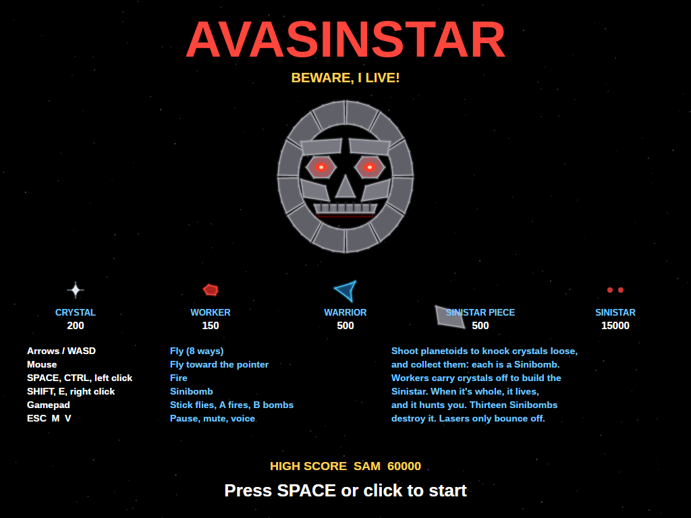 | 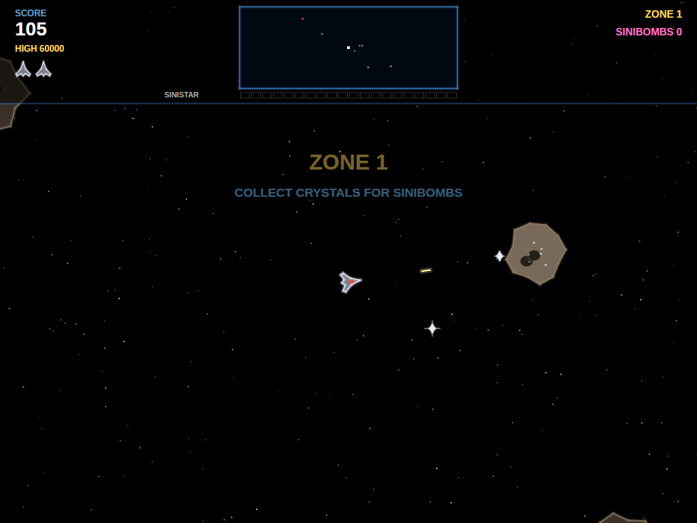 | 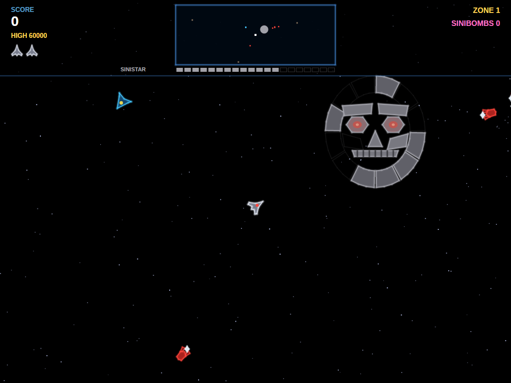 |
| The Sinistar, complete and grinning, with what everything is worth. | Shots knock crystals loose from a planetoid. | Workers bring crystals to the building site; missing pieces show as outlines. |

| Warriors | Beware, I live! | Sinibombs |
|:--------:|:---------------:|:---------:|
| 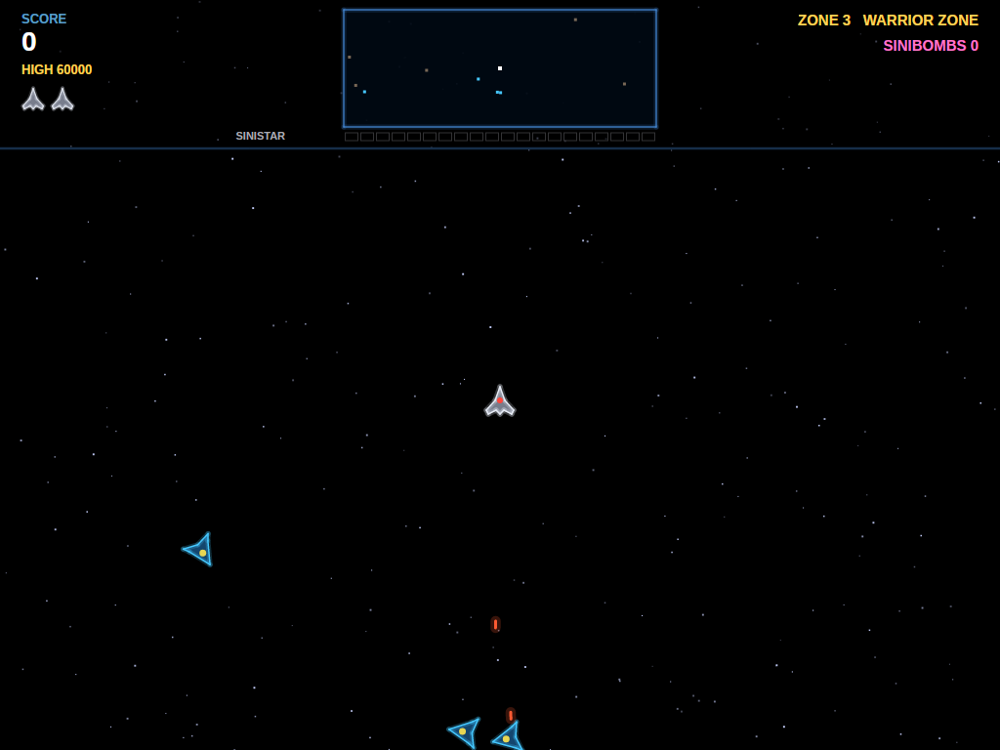 | 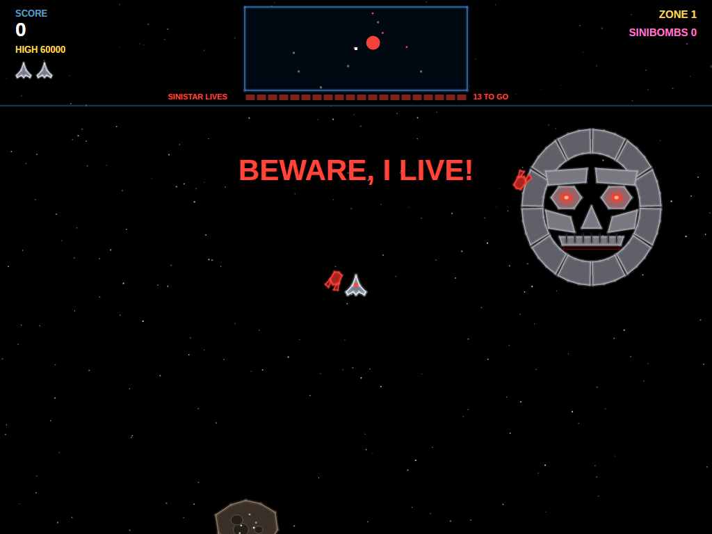 | 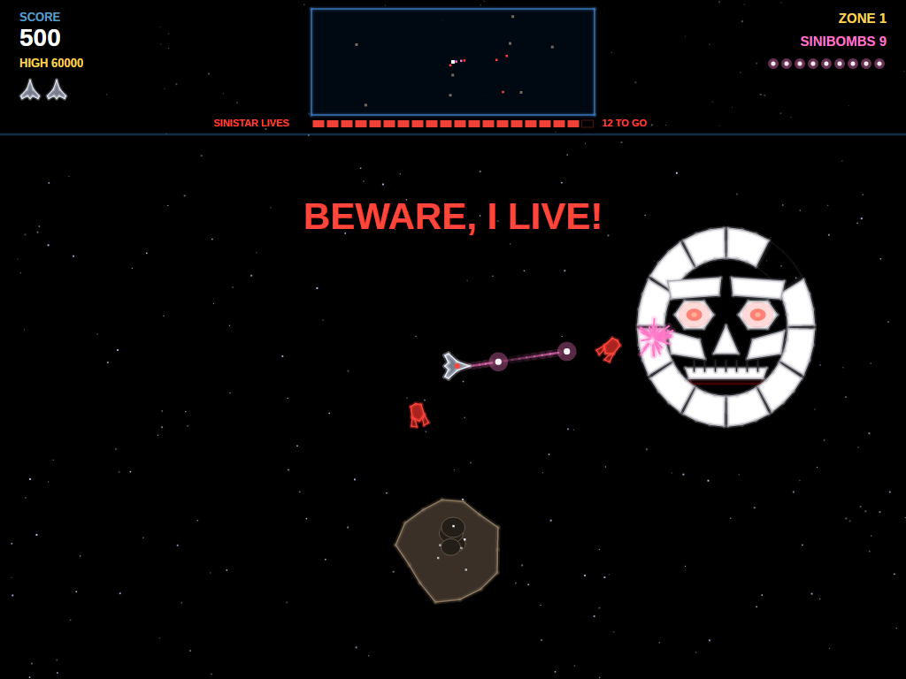 |
| A warrior zone: warriors close in, firing. | The last piece goes in, its eyes burn and it comes for you. | Sinibombs home in and blast pieces off it. |

| Sinistar destroyed | Attract mode | Game over |
|:------------------:|:------------:|:---------:|
| 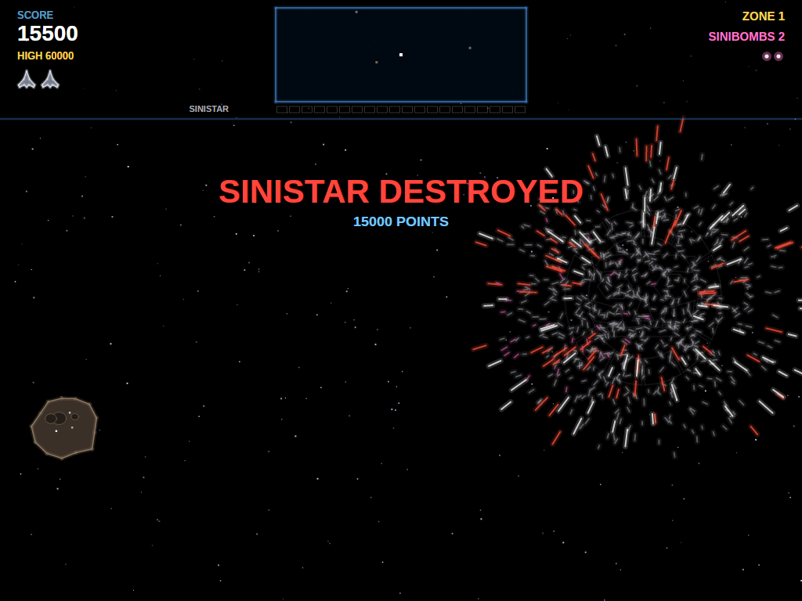 | 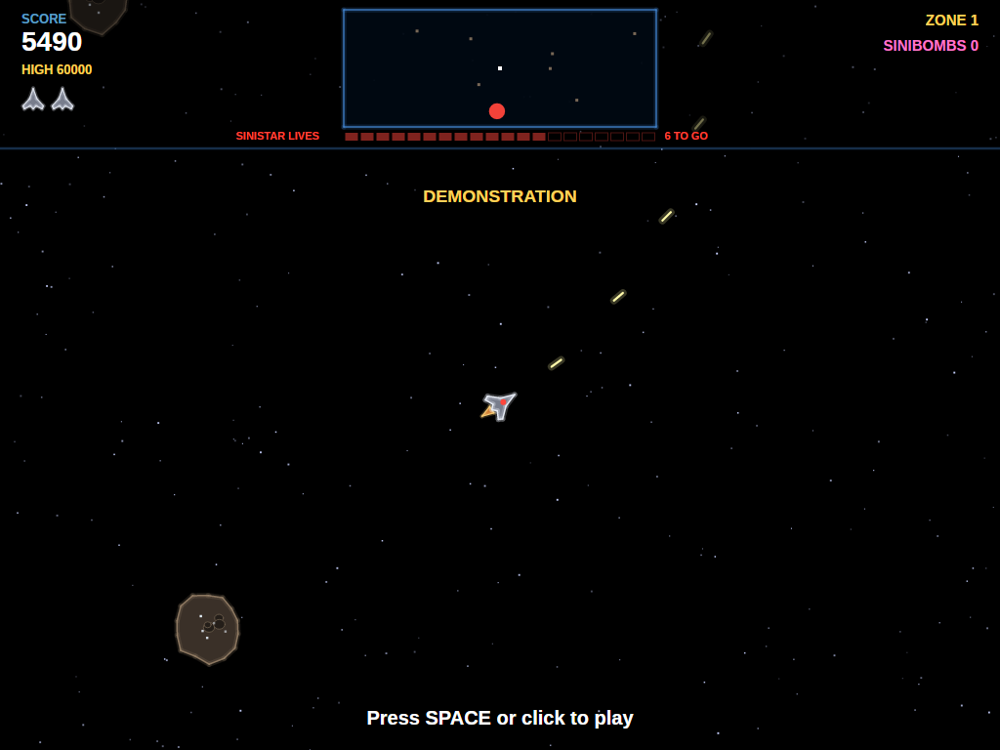 | 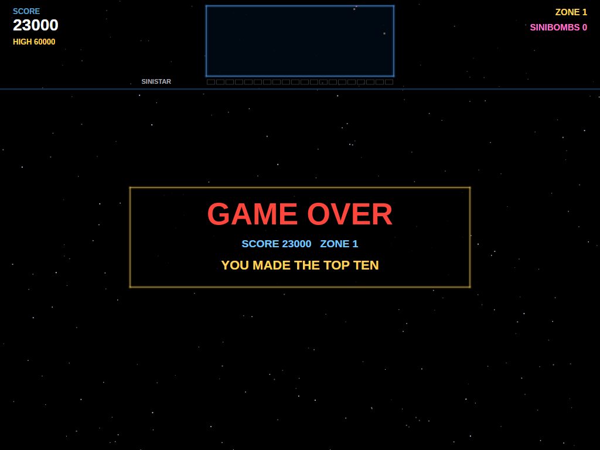 |
| Thirteen bombs, and it flies apart. On to the next zone. | Left alone, the game plays itself, silently. | Out of ships. |

| Entering initials | The high-score table |
|:-----------------:|:--------------------:|
| 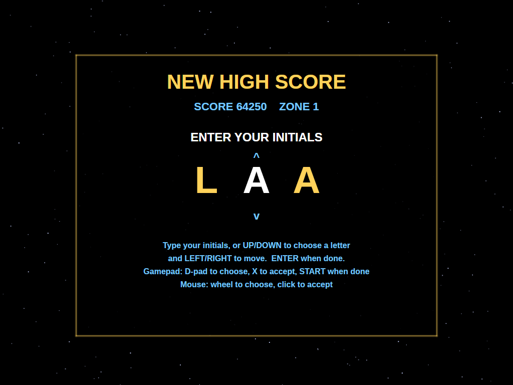 | 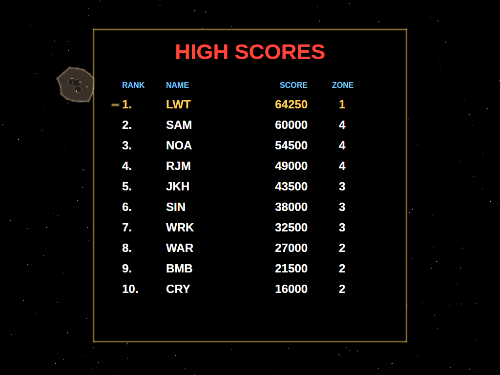 |
| A score that makes the top ten earns three initials. | The new entry flashes in the table. |

## Download and run

Ready-to-run builds for Windows, macOS and Linux, on both Intel/AMD and ARM, are on the
[Releases page](https://github.com/Harlock123/AVASinstar/releases). **Latest build** is rebuilt on every
push to `main`. Each download is one self-contained executable: no .NET install is needed.

```bash
tar -xzf AVASinstar-linux-arm64.tar.gz     # or linux-x64, linux-arm, osx-arm64, osx-x64
./AVASinstar
```

On Windows, unzip `AVASinstar-win-x64.zip` (or `-win-arm64`, `-win-x86`) and run `AVASinstar.exe`. On
macOS, if Gatekeeper refuses to open it, run `xattr -d com.apple.quarantine AVASinstar` once.

### Linux: sound and gamepads

- **Sound** needs `aplay`, from the `alsa-utils` package. Without it the game runs but is
  silent. Minimal installs (Arch, Omarchy, some Raspberry Pi images) don't include it:

  ```bash
  sudo apt install alsa-utils             # Debian / Ubuntu / Raspberry Pi OS
  sudo pacman -S --needed alsa-utils      # Arch / Omarchy
  ```

- **Gamepads** use SDL2. It is bundled for Windows, macOS and Intel/AMD Linux, but **ARM Linux builds need it
  installed**. Without it the keyboard and mouse still work; only the controller does not:

  ```bash
  sudo apt install libsdl2-dev            # Debian / Ubuntu / Raspberry Pi OS
  sudo pacman -S --needed sdl2-compat     # Arch / Omarchy
  ```

  On Debian-based systems it has to be `libsdl2-dev`: the game looks for `libSDL2.so`, which
  the runtime-only `libsdl2-2.0-0` package doesn't provide.

## Requirements

- .NET 10 SDK (to build; the released executables need nothing)
- Windows, macOS or Linux

## Building and Running

```bash
cd AVASINStar
dotnet build
dotnet run
```

## Controls

The cabinet had a 49-way joystick (seven positions each way), so the ship could fly at different speeds
as well as in different directions, with a fire button and a Sinibomb button.

### Keyboard

| Key | Action |
|-----|--------|
| **Arrows** / **W A S D** | Fly (eight directions, full speed) |
| **Space** / **Ctrl** | Fire (hold to keep firing) |
| **Shift** / **E** / **F** / **Z** | Launch a Sinibomb |
| **Esc** | Pause (Esc again to quit) |
| **M** | Mute all sound |
| **V** | The Sinistar's voice on/off |

### Mouse

| Input | Action |
|-------|--------|
| **Move** | Fly toward the pointer: the further it is from the ship, the faster |
| **Left Button** | Fire |
| **Right** / **Middle Button** | Launch a Sinibomb |

Pressing a steering key hands control back from the mouse to the keyboard.

### Controller (Xbox/PlayStation/Switch Pro)

| Input | Action |
|-------|--------|
| **Left Stick** | Fly: as far as it's pushed, as fast as you go |
| **D-Pad** | Fly in eight directions |
| **A** / **X** / **Right Bumper** / **Right Trigger** | Fire |
| **B** / **Y** / **Left Bumper** / **Left Trigger** | Launch a Sinibomb |
| **Start** | Pause / Resume game |
| **Back/Select** (while paused) | Exit game |

### Entering initials

| Key | Action |
|-----|--------|
| **A**–**Z**, **0**–**9**, **.** | Type a letter and move to the next |
| **Up** / **Down** | Dial the current letter |
| **Left** / **Backspace**, **Right** | Move between letters |
| **Space** | Accept the letter |
| **Enter** | Done |

Gamepad: D-pad dials and moves, **X** accepts, **Start** finishes. Mouse: the wheel dials, a click accepts.

### Other

| Key | Action |
|-----|--------|
| **Ctrl+S** / **Cmd+S** | Save screenshot to Pictures folder |

## Gameplay

### Crystals and Sinibombs

Planetoids hold crystals. Each shot that strikes one has a chance to knock a crystal loose; fly into it to
collect it, and it becomes a Sinibomb. You can carry twenty. Planetoids slowly grow new crystals, so a
sector is never mined out for good.

A Sinibomb, once launched, finds its own way to the Sinistar, wherever it is. With no Sinistar to find, it
fizzles out.

### The workers and the building site

Somewhere in the sector is the Sinistar's building site, shown on the scanner. Red workers gather loose
crystals, or mine them straight out of planetoids, and carry them there: every crystal delivered adds a
piece. Shoot a worker carrying a crystal and it drops it, for you to take.

Warriors attack you on sight. When you're far away they shoot at planetoids to free crystals for the
workers.

### The Sinistar

While it's being built, every Sinibomb that reaches it knocks two pieces off. Once all twenty are in place
it wakes, with a roar and *"Beware, I live!"*, and hunts you. It's slower than your ship at full speed,
but not by much. If it catches you, it eats your ship.

Thirteen Sinibombs destroy a living Sinistar. Each one knocks a piece off; from the second zone on,
workers that reach it put pieces back, and each piece they replace means one more bomb needed. Your lasers
just bounce off it.

### Zones

After the Sinistar is destroyed, the next zone begins with a new sector and a new Sinistar to stop. The
first zone is followed by the **Worker Zone** (more workers), the **Warrior Zone** (more warriors), the
**Planetoid Zone** (more planetoids) and the **Void Zone** (very few planetoids, and so few crystals),
and round again. Each zone is a little faster and fiercer than the last.

### Ships

You start with three ships and earn another every 25,000 points.

## Scoring

| Target | Points |
|--------|--------|
| Shot on a planetoid | 5 |
| Worker | 150 |
| Crystal collected | 200 |
| Warrior | 500 |
| Sinistar piece knocked off | 500 |
| Sinistar destroyed | 15,000 |

## Sound Effects

All effects are synthesised by `tools/make_sounds.py`; nothing is sampled from the original machine. The
Sinistar's words are made by `tools/make_voice.sh` with the [Piper](https://github.com/rhasspy/piper)
text-to-speech engine, then pitched down and run through `tools/sinistar_voice.py`, an emulation of the
cabinet's CVSD speech chip. Its roar and death scream are synthesised.

| Sound | When |
|-------|------|
| `Fire.wav`, `RockHit.wav` | Your gun, and a shot striking a planetoid |
| `Crystal.wav`, `Pickup.wav` | A crystal knocked loose, and collected |
| `BombLaunch.wav`, `BombHit.wav` | A Sinibomb launched, and striking the Sinistar |
| `WorkerBoom.wav`, `WarriorBoom.wav`, `ShipBoom.wav` | Ships blowing up |
| `WarriorFire.wav` | A warrior's shot |
| `Piece.wav` | A piece added to the Sinistar |
| `Roar.wav`, `VoiceScream.wav`, `SinistarBoom.wav` | It wakes or feeds; it dies |
| `Heartbeat.wav` | Its heartbeat once it lives (loops) |
| `Thrust.wav` | Your engine (loops) |
| `Zone.wav`, `ExtraShip.wav`, `Empty.wav` | A new zone, an extra ship, out of bombs |
| `Voice*.wav` | *Beware, I live!*, *I hunger!*, *Run, coward!*, *I am Sinistar!*, *Beware, coward!*, *Run! Run! Run!*, *I hunger, coward!* |

## Project Structure

```
AVASINStar/
├── AVASinstar.csproj, AVASinstar.slnx
├── Program.cs, App.axaml(.cs), MainWindow.axaml(.cs)
├── Engine/
│   ├── GameEngine.cs           # States, the ship, shots, crystals, scoring and lives
│   ├── GameEngine.Enemies.cs   # Zones, workers and warriors
│   ├── GameEngine.Sinistar.cs  # The Sinistar, Sinibombs, the next zone
│   ├── AttractPilot.cs         # The computer pilot for attract mode
│   ├── HighScoreTable.cs, InitialsEntry.cs
│   ├── InputHandler.cs         # The 49-way stick from keyboard, mouse and gamepad
│   ├── ControllerManager.cs    # SDL2 gamepad support
│   └── SoundManager.cs         # Effects, loops, and the Sinistar's voice queue
├── Models/
│   ├── World.cs                # The wrapping sector
│   ├── Entities.cs             # Ship, planetoids, crystals, workers, warriors, shots, Sinibombs, the Sinistar
│   ├── GameObject.cs, Explosion.cs
├── Views/
│   ├── GameCanvas.cs           # Input, game loop, overlays
│   ├── GameCanvas.Space.cs     # Stars, rocks, ships, the Sinistar's face
│   ├── GameCanvas.Screens.cs   # Readouts, scanner, title, entry and table screens
│   └── GameCanvas.Draw.cs      # Glowing shapes, lines and text
├── Sounds/                     # Generated WAV files
├── Images/                     # README screenshots
└── tools/
    ├── make_sounds.py          # Synthesises the effects, the roar and the scream
    ├── make_voice.sh           # Speaks the Sinistar's lines with Piper
    └── sinistar_voice.py       # Pitches them down through a CVSD speech-chip emulation
```

## Technical Details

- **Framework**: Avalonia UI 12.1 on .NET 10
- **Audio**: NetCoreAudio for cross-platform sound playback
- **Controller**: SDL2 GameController API for cross-platform gamepad support
- **The sector** is a 7,000-unit square that wraps at its edges; the ship stays in the middle of the screen
  and space scrolls past, with three layers of stars for depth.
- **The Sinistar's face** is twenty polygons; each is drawn solid when built and as a faint outline when
  not, with the jaw opening and closing once it lives.
- **The voice**: CVSD (continuously variable slope delta) modulation sends one bit per sample, growing its
  step when three bits in a row agree and shrinking it otherwise; decoding that gives the cabinet's
  distinctive gritty speech.
- **Rendering**: a custom `Control` with `DrawingContext`; filled shapes with glowing outlines.
- **Screen**: a fixed 1024×768 screen, scaled to fit any window size with letterboxing
- **Game Loop**: 60 FPS using `DispatcherTimer`
- **High scores**: saved to `AVASinstar/highscores.txt` in the user's application-data folder
  (`~/.config` on Linux, `%APPDATA%` on Windows, `~/Library/Application Support` on macOS)

## Roadmap

### Done

- The Sinistar, built piece by piece and destroyed by Sinibombs, with its voice, roar and scream
- Planetoids, crystals, workers and warriors, and the cabinet's cycle of zones
- The 49-way-style stick from keyboard, mouse and gamepad
- Synthesised sound, attract mode, top-ten high scores with initials, screenshots, mute and voice toggles
- Self-contained single-file releases for 8 platforms on every push to `main`

### Planned

- Warriors that can shoot down Sinibombs, as on the cabinet
- Planetoids that break apart when shot too hard
- Two-player alternating games

## Credits

Sinistar was designed by Sam Dicker, Noah Falstein, RJ Mical and Jack Haeger and released by Williams in
1983. This is a fan recreation of its gameplay; no code, graphics or sound from the original are used.
Sinistar is a trademark of its owner, and this project is not affiliated with or endorsed by it.

The Sinistar's voice was made with Piper using the `en_GB-vctk-medium` voice, trained on the
[CSTR VCTK corpus](https://datashare.ed.ac.uk/handle/10283/3443) (CC BY 4.0), speaker p345.

## License

MIT License
